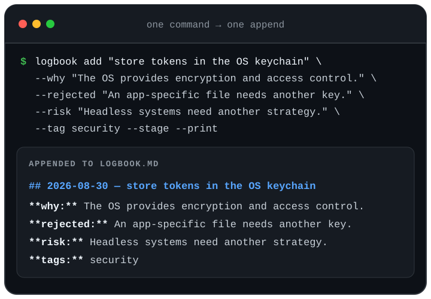
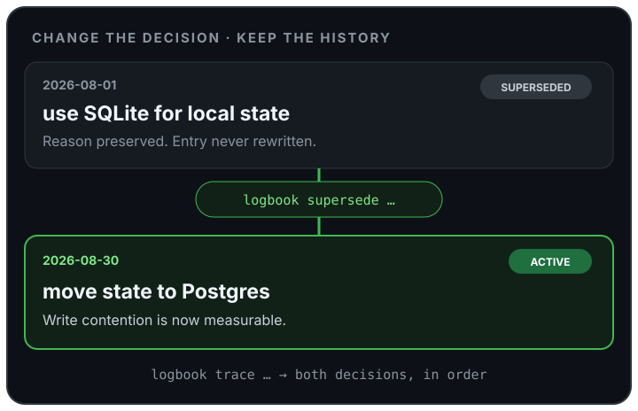
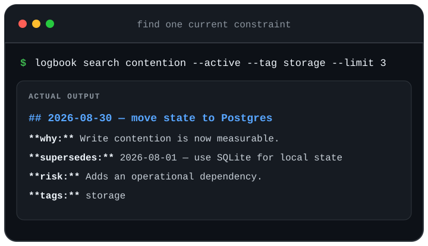
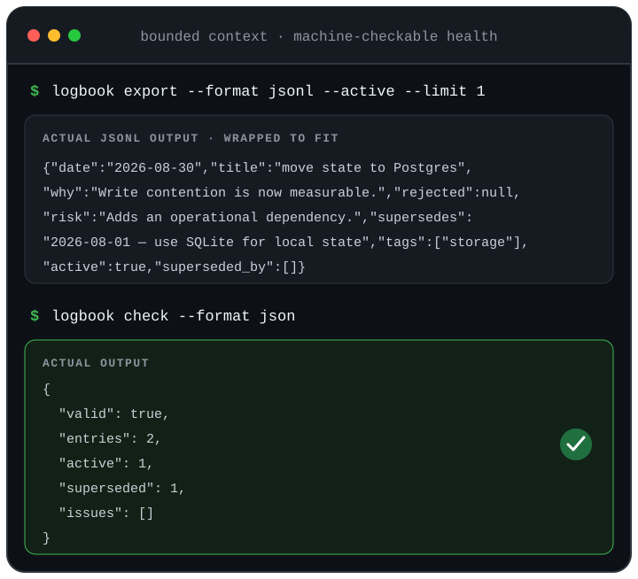

# logbook

A command-line tool that keeps the decisions behind a repository in one Markdown file, `logbook.md`.

Code tells you what it does. Git tells you what changed. Logbook tells you why.

```bash
$ logbook add "store tokens in the OS keychain" \
    --why "The OS provides encryption and access control." \
    --rejected "An app-specific file needs another key." \
    --risk "Headless systems need another strategy." \
    --tag security --stage --print
added: 2026-08-30 — store tokens in the OS keychain
---
## 2026-08-30 — store tokens in the OS keychain
**why:** The OS provides encryption and access control.
**rejected:** An app-specific file needs another key.
**risk:** Headless systems need another strategy.
**tags:** security

staged /home/alice/project/logbook.md
```



One command appends an entry and stages `logbook.md` next to the code it explains.

## Changing a decision

When an earlier choice stops holding, you do not rewrite its entry. You supersede it:

```bash
$ logbook supersede 2026-08-01 "move state to Postgres" \
    --old-title "use SQLite for local state" \
    --why "Write contention is now measurable." \
    --risk "Adds an operational dependency." \
    --tag storage --stage
```

`--old-title` is only needed when several entries share that date. To see the whole chain:

```bash
$ logbook trace 2026-08-01 --title "use SQLite for local state"
## 2026-08-01 — use SQLite for local state
**why:** It keeps installation to one binary and one data file.
**rejected:** Postgres requires a service for a single-user tool.
**risk:** Write concurrency is limited.
**tags:** storage

## 2026-08-30 — move state to Postgres
**why:** Write contention is now measurable.
**supersedes:** 2026-08-01 — use SQLite for local state
**risk:** Adds an operational dependency.
**tags:** storage
```



The old entry stays as written. The new one points back to it with a `**supersedes:**` line and becomes the active decision.



`list`, `search` and `export` can filter by active or superseded, by tag and by date range.

## Why one Markdown file

Each repository gets one `logbook.md`, reviewed and versioned in Git with the code it constrains. There is no service, database or account behind it, and the tool makes no network calls. [CONTRIBUTING.md](CONTRIBUTING.md) lists what stays out of scope.

Write an entry when a choice is not obvious, will affect later work, and has a reason the diff does not show. Skip routine changes and status updates. Do not backfill a diary. Start with the next decision you would otherwise have to work out again.

**One successor.** A decision has at most one successor. To reverse the current decision you supersede it, and you never branch from an old one. `logbook check` flags malformed entries and broken, ambiguous, duplicate or branched links.

**A file you can edit.** The entries are ordinary Markdown, so hand edits are fine. Commands that write take a short-lived lock and replace the file through a synced temporary file beside it. A crash cannot leave half an entry, and two writers cannot overwrite each other.

**A short list for coding agents.** An agent does better with the current decisions than with the whole history:

```bash
logbook list --active --limit 10
logbook export --format jsonl --active --limit 10
logbook check --format json
```



`export` writes JSON or JSON Lines in file order. `check --format json` reports whether the file is valid and lists any issues.

Suggested repository instructions:

```markdown
Before product, architecture, or operational work, run
`logbook list --active --limit 10` and treat those decisions as constraints.
Record only new non-obvious decisions. Supersede reversals instead of rewriting
earlier entries.
```

## Install

With Rust 1.85 or newer:

```bash
cargo install logbook --locked
```

Prebuilt archives for Linux, macOS and Windows, with a `SHA256SUMS` file, are on the [latest GitHub release](https://github.com/jeffbai996/logbook/releases/latest).

## Usage

```bash
logbook add "keep the API synchronous"                  # opens $EDITOR or $VISUAL when --why is left out
printf '%s\n' "A daemon adds lifecycle work." |
  logbook add "avoid a background worker" --why - --tag architecture

logbook list --active --limit 10
logbook search "write contention" --tag storage
logbook show 2026-08-01
logbook last
logbook tags
logbook stats
logbook where
```

`add` creates `logbook.md` if it is missing. Only the title and the reason are required. `--rejected`, `--risk` and `--tag` are optional, and `--tag` can repeat. `--date YYYY-MM-DD` records a decision made earlier. In the editor, lines whose first non-space character is `#` are comments, and an empty reason cancels the entry.

`--stage` runs `git add` on the file after writing. Logbook never commits. If staging fails, the entry is still saved, and the error prints the `git add` command to run.

The other commands: `init` creates an empty logbook and leaves an existing one alone, `check` validates the file, `export` writes JSON or JSON Lines, and `completions` prints a script for bash, elvish, fish, powershell or zsh. `stats` prints the totals, the date range, the entries from this month and the number of tags. `--file PATH` and `--color auto|always|never` work on every command, and `logbook <command> --help` lists the rest.

`list`, `search` and `export` share `--tag` (repeatable, and every tag must match, ignoring case), `--since`, `--until`, `--active`, `--superseded` and `--limit`. `list` and `search` print the newest matches first. `show` and `export` keep file order, and `trace` runs from the oldest decision to the newest. With `--limit`, `export` keeps the last N matches.

## Configuration and file format

The file is found in this order: `--file PATH`, then `LOGBOOK_FILE`, then the nearest `logbook.md` found by walking up from the current directory to the Git root. If none exists, the new file goes at the Git root, or in the current directory outside a repository. The editor is `$EDITOR`, then `$VISUAL`.

Each entry is a `## date — title` heading followed by labelled lines: `why`, then optional `rejected`, `risk` and `tags`, and `supersedes` on a replacement. The trace output above is the format.

- In a multiline field, indent any continuation line that starts with `## ` or a field label such as `**why:**`. Unindented lines like that are rejected, so the file cannot become ambiguous.
- Writing through a `logbook.md` symlink is refused, because the atomic rename would replace the symlink itself. Pass `--file` with the target path instead.
- If a crashed process leaves `<logbook path>.lock`, check that no `logbook` writer is running, remove that directory, and try again.

## Development

```bash
cargo test --locked
cargo +1.85.0 test --locked
cargo fmt --all -- --check
cargo clippy --locked --all-targets -- -D warnings
cargo build --release --locked
cargo package --locked
```

CI runs on Linux, macOS and Windows, and on the Rust 1.85 minimum. The 0.5 series is feature-complete. Bug fixes, portability work and dependency upkeep are welcome (see [CONTRIBUTING.md](CONTRIBUTING.md)).

## License

[MIT](LICENSE)
