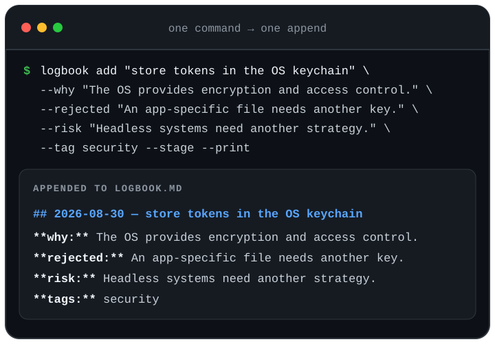
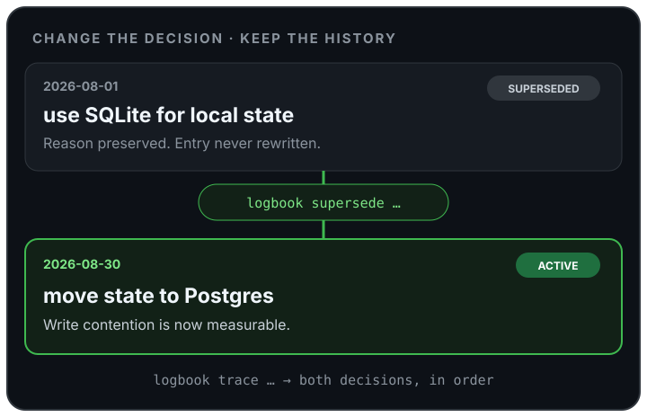
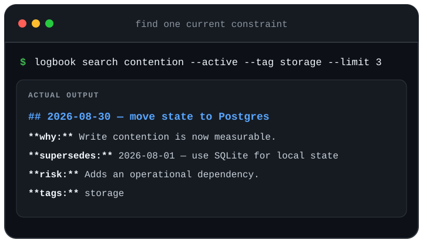
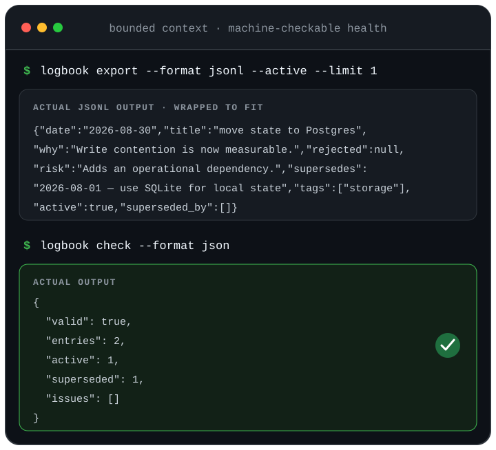

# logbook

A CLI for recording the decisions that shape a repository in one append-only `logbook.md`.

Code tells you what it does. Git tells you what changed. Logbook tells you why.

```bash
$ logbook add "store tokens in the OS keychain" \
    --why "The OS provides encryption and access control." \
    --rejected "An app-specific file needs another key." \
    --risk "Headless systems need another strategy." \
    --tag security --stage --print
## 2026-08-30 — store tokens in the OS keychain
**why:** The OS provides encryption and access control.
**rejected:** An app-specific file needs another key.
**risk:** Headless systems need another strategy.
**tags:** security
```



One command appends a plain Markdown entry and stages `logbook.md` alongside the code it explains.

## What a decision chain looks like

When an earlier choice stops holding, you do not rewrite the old entry into a new reality. You supersede it:

```bash
$ logbook supersede 2026-08-01 "move state to Postgres" \
    --old-title "use SQLite for local state" \
    --why "Write contention is now measurable." \
    --risk "Adds an operational dependency." \
    --tag storage --stage

$ logbook trace 2026-08-01 --title "use SQLite for local state"
## 2026-08-01 — use SQLite for local state (superseded by 2026-08-30 — move state to Postgres)
**why:** It keeps installation to one binary and one data file.
**rejected:** Postgres requires a service for a single-user tool.
**risk:** Write concurrency is limited.
**tags:** storage

## 2026-08-30 — move state to Postgres (active)
**why:** Write contention is now measurable.
**supersedes:** 2026-08-01 — use SQLite for local state
**risk:** Adds an operational dependency.
**tags:** storage
```



The original entry stays intact; the replacement links back with `**supersedes:**` and becomes the active constraint.



`logbook search` and `logbook list` filter by active or superseded status, tag, and date range.

## Why one Markdown file

Each repository gets one `logbook.md` reviewed and versioned in Git with the code it constrains. There is no service, database, account, project scaffolding, GUI, daemon, telemetry, LLM integration, or sync layer; those belong in other tools.

Write an entry when a choice is non-obvious, affects future work, and its reason is not clear from the diff. Skip routine changes, status updates, and things the code already says better. Do not backfill a project diary: start with the next decision you would otherwise have to reverse-engineer.

- **Linear supersession.** A decision has at most one successor, so you reverse the current decision rather than branching an old one. `logbook check` validates the file and flags malformed entries or broken, ambiguous, duplicate, or branched links.
- **Hand-editable, atomic writes.** The file is ordinary Markdown you can edit by hand. CLI writes take a short-lived directory lock (`<logbook path>.lock`) and replace the file atomically through an `fsync`ed sibling temp file, so a crash cannot leave a half-written entry and concurrent writers do not clobber each other.
- **Bounded slices for coding agents.** Give an agent the current active constraints rather than the whole history:

```bash
logbook list --active --limit 10
logbook export --format jsonl --active --limit 10
logbook check --format json
```



`export` emits stable JSON or JSON Lines in document order, and `check --format json` reports structural health.

Suggested repository instructions:

```markdown
Before product, architecture, or operational work, run
`logbook list --active --limit 10` and treat those decisions as constraints.
Record only new non-obvious decisions. Supersede reversals instead of rewriting
earlier entries.
```

## Install

With Rust 1.85 or newer:

```bash
cargo install logbook --locked
```

Prebuilt Linux, macOS, and Windows archives and `SHA256SUMS` are attached to the [latest GitHub release](https://github.com/jeffbai996/logbook/releases/latest).

## Usage

```bash
logbook add "keep the API synchronous"                  # opens $EDITOR or $VISUAL when --why is omitted
printf '%s\n' "A daemon adds lifecycle work." |
  logbook add "avoid a background worker" --why - --tag architecture

logbook list --active --limit 10
logbook search "write contention" --tag storage
logbook show 2026-08-01
logbook last
logbook tags
logbook stats
logbook where
```

`add` creates `logbook.md` when needed. Only the title and reason are required; `--rejected`, `--risk`, and repeatable `--tag` are optional, and `--date YYYY-MM-DD` imports a decision made earlier. In the editor, lines whose first non-space character is `#` are stripped as comments, and an empty reason aborts the write.

`--stage` runs `git add -- <path>` after the file is updated on disk; `logbook` never commits automatically. If staging fails, the entry stays saved and the error prints the `git add -- "<path>"` command to run.

| Command | Purpose |
|---|---|
| `init [--stage]` | Create an empty logbook without overwriting an existing one. |
| `add <title> [options]` | Append a decision from `--why <text>`, `--why -` (stdin), or an editor. |
| `list [filters]` | Print matching decisions newest-first (`--search <term>` optional). |
| `search <term> [filters]` | Search all entry text case-insensitively, newest-first. |
| `last` | Print the most recently appended decision. |
| `show <date> [--title T]` | Print decisions on `YYYY-MM-DD` in file order. |
| `supersede <old-date> <title> [options]` | Append a replacement decision (`--old-title T` disambiguates same-day entries). |
| `trace <date> [--title T] [--format human\|json]` | Print one complete decision chain from root to newest successor. |
| `check [--format human\|json]` | Validate entries and the supersession graph. |
| `export [--format json\|jsonl] [filters]` | Emit machine-readable records in document order (`--search <term>` optional). |
| `tags` | List normalized tags and their entry counts. |
| `stats` | Summarize total, active, and superseded decisions, date span, and top tags. |
| `where` | Print the resolved `logbook.md` path. |
| `completions <shell>` | Generate shell completions (`bash`, `elvish`, `fish`, `powershell`, `zsh`). |

Global flags on every command: `--file <PATH>` and `--color <auto|always|never>`. Run `logbook <command> --help` for all options.

`list`, `search`, and `export` share `--tag <TAG>` (repeatable, ANDed case-insensitively), `--since YYYY-MM-DD`, `--until YYYY-MM-DD`, `--active`, `--superseded`, and `--limit N`. `list` and `search` return the newest matches first; `show` keeps file order; `trace` keeps chain order; `export` keeps document order (when `--limit N` is passed to `export`, it keeps the last `N` matching entries in document order).

## Configuration and file format

- **Path resolution:** `--file PATH`, then `LOGBOOK_FILE`, then the nearest `logbook.md` walking up from the current directory to the `.git` repository root (defaulting to `<repo-root>/logbook.md` before the file exists).
- **Editor:** `$EDITOR`, then `$VISUAL`.

```markdown
## 2026-08-01 — use SQLite for local state
**why:** It keeps installation to one binary and one data file.
**rejected:** Postgres requires a service for a single-user tool.
**risk:** Write concurrency is limited.
**tags:** storage

## 2026-08-20 — move state to Postgres
**why:** Write contention is now measurable.
**supersedes:** 2026-08-01 — use SQLite for local state
**risk:** Adds an operational dependency.
**tags:** storage
```

- In multiline fields passed by flag or stdin, indent any continuation line that begins with `## ` or a field label (`**why:**`, `**supersedes:**`, `**rejected:**`, `**risk:**`, `**tags:**`); unindented structural lines are rejected so the file cannot become ambiguous.
- Writes refuse a `logbook.md` symlink because atomic rename would replace the symlink itself; pass `--file` with the target path instead.
- If a crashed process leaves `<logbook path>.lock`, confirm no `logbook` writer is running, remove that directory, and retry.

## Development

```bash
cargo test --locked
cargo +1.85.0 test --locked
cargo fmt --all -- --check
cargo clippy --locked --all-targets -- -D warnings
cargo build --release --locked
cargo package --locked
```

CI covers Linux, macOS, Windows, and the Rust 1.85 MSRV. The 0.5 series is feature-complete; bug fixes, portability work, and dependency upkeep are welcome ([CONTRIBUTING.md](CONTRIBUTING.md)).

## License

[MIT](LICENSE)
